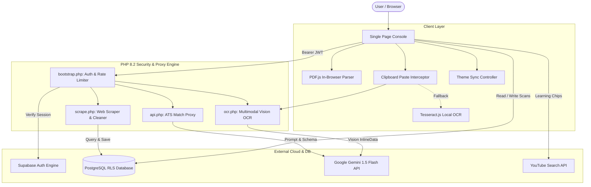

# SkillSync Technical Architecture

## Overview
SkillSync is an AI-powered resume and job description match analyzer that replicates enterprise Applicant Tracking System (ATS) parsing algorithms.

## Core Components
1. **Frontend**: Static HTML5/JavaScript application with Tailwind CSS, DM Sans & Fraunces typography, and glassmorphic micro-interactions.
2. **Document Processing**: Client-side PDF parsing via `PDF.js` and multimodal image transcription via `ocr.php` and `Gemini 1.5 Flash`.
3. **Database & Auth**: Supabase PostgreSQL with Row Level Security (RLS) guaranteeing user data isolation.
4. **Proxy Layer**: PHP 8.2 FastCGI with SSRF protection, Bearer token verification, file-locked sliding window rate limiting (5 req/min), and secure error suppression.
