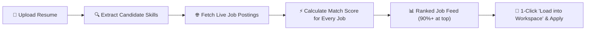

# 🗺️ SkillSync Roadmap: Smart Job Discovery Feed

> **Vision**: Transform SkillSync from a standalone ATS resume checker into a **Reverse ATS Job Matcher**.  
> Instead of applicants applying blindly on LinkedIn and getting ghosted, they upload their resume once and immediately see open tech jobs pre-scored and ranked by exact compatibility.

---

## 1. Core User Flow



1. **Upload Resume**: Candidate uploads or pastes their resume in the console.
2. **Fetch Live Jobs**: The system queries live, remote, and tech job feeds based on extracted skill keywords (e.g. `React`, `PHP`, `Node`, `DevOps`).
3. **Pre-Score Each Job**: Every job card dynamically displays an ATS match badge:
   - 🟢 **92% Strong Match** (Vercel — Full Stack Engineer)
   - 🟡 **74% Good Fit** (Stripe — Backend Developer)
   - 🔴 **45% Low Fit** (Datadog — Site Reliability Engineer)
4. **1-Click "Load into Workspace"**:
   - Clicking any job instantly injects its job description into the ATS Matcher.
   - Highlights exact missing skills and generates customized preparation/application notes.

---

## 2. Technical Architecture

### A. Data Feeds (100% Free & Open APIs)
No paywalls, enterprise contracts, or complex OAuth required:
* **Arbeitnow API** (`https://www.arbeitnow.com/api/job-board-api`):
  * Free public REST JSON endpoint.
  * Rich software engineering, remote, and European/US tech roles with tags and clean HTML descriptions.
* **RemoteOK API** (`https://remoteok.com/api`):
  * Open JSON feed of active remote software engineering jobs.
* **Database Cache Layer**:
  * Cached in Supabase / SQLite via `backend/services/jobs.php` to prevent redundant external API calls and ensure instant load times.

### B. Backend Services
* **`backend/services/jobs.php`**:
  * Fetches, filters, and standardizes job listings into a unified schema:
    ```json
    {
      "id": "job_102",
      "company": "Vercel",
      "title": "Senior Frontend Engineer",
      "location": "Remote (Global)",
      "salary": "$140k - $180k",
      "tags": ["react", "typescript", "nextjs", "tailwind"],
      "description": "...",
      "url": "https://...",
      "posted_at": "2026-10-31"
    }
    ```

### C. Frontend Interface (`app.html`)
* **Dual-View Workspace Toggle**:
  * Tab 1: `[ ATS Matcher ]` (Current manual evaluation workspace)
  * Tab 2: `[ Discover Matching Jobs ]` (Live pre-scored job feed)
* **Interactive Job Card**:
  * Company logo/avatar, role title, location, salary tier.
  * Real-time match percentage badge with color coding (`var(--sage)`, `var(--amber)`, `var(--rose)`).
  * Direct "Apply on Company Site" button.
  * "Load & Tailor" button to run immediate skill gap analysis.

---

## 3. Implementation Plan (When Ready to Build)

| Phase | Milestone | Description |
| :--- | :--- | :--- |
| **Phase 1** | **Backend Proxy & Feed Service** | Create `backend/services/jobs.php` with 1-hour caching and query filtering. |
| **Phase 2** | **Discovery Feed UI** | Build the clean, minimal job board tab and card grid in `app.html` adhering to the FortiFocus theme. |
| **Phase 3** | **Client-Side Pre-Scoring Engine** | Match extracted candidate resume skills against job requirements in real-time. |
| **Phase 4** | **1-Click Workspace Integration** | Seamlessly bridge the job card with the ATS analysis panel. |
| **Phase 5** | **Testing & CI** | Add automated Jest unit tests verifying job feed rendering and match score computation. |

