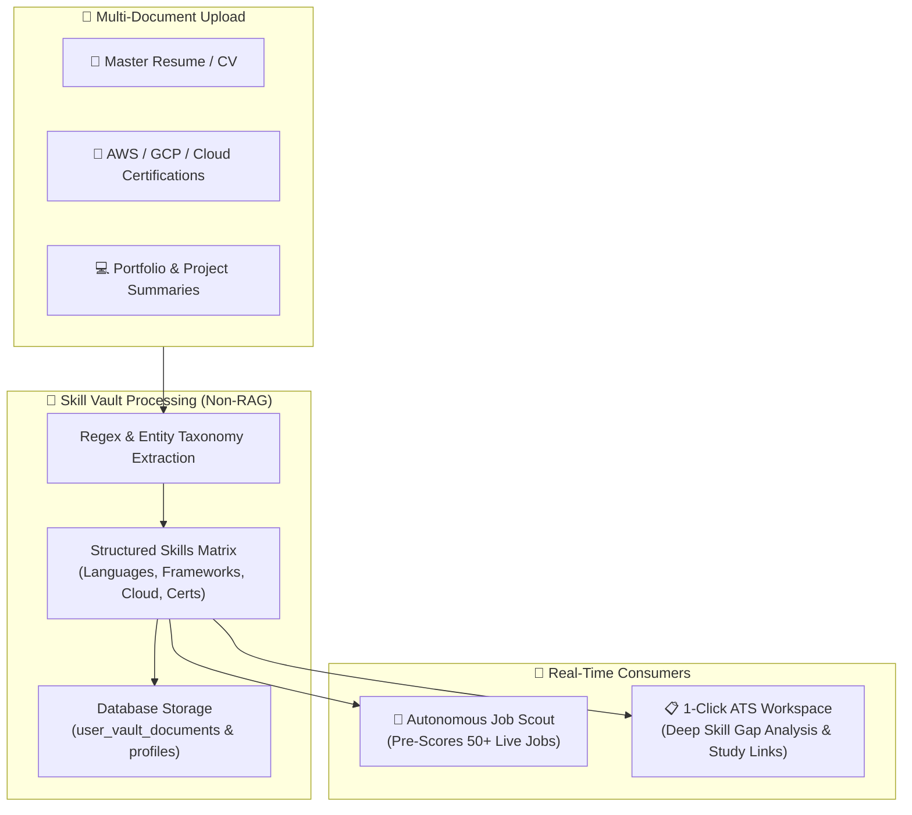

# 🔐 SkillSync: Skill Vault & Unified Credential Profile System

> **Architecture Guide**: Multi-document credential storage, deterministic non-RAG skill matrix extraction, and real-time Autonomous Job Scout pre-scoring.

---

## 1. System Overview & Design Philosophy

Traditional ATS preparation platforms restrict candidates to a single copy-pasted text box. When candidates hold multiple certifications (e.g. AWS Solutions Architect, CKA), specialized project writeups, and updated CVs, they are forced to manually blend them together.

**Skill Vault** solves this by acting as the candidate's personal technical credential repository:
1. **Multi-Document Storage**: Candidates upload multiple resumes, official cloud certifications, and project briefs.
2. **Deterministic Entity Extraction (Non-RAG)**: Avoids heavy vector databases and hallucination-prone vector similarity chunks. Instead, it extracts structured skill taxonomies directly through deterministic pattern matching and verified entity synthesis.
3. **Verified Skills Matrix**: Automatically aggregates and categorizes skills across **Languages**, **Frameworks**, **Cloud & Infrastructure**, and **Certifications**.
4. **Autonomous Job Scout Engine**: Live jobs in the Job Discovery Feed automatically evaluate against the synthesized vault matrix, showing real-time match percentages (e.g. **96% Strong Match**) without requiring repeated uploads.
5. **1-Click Workspace Sync**: Formats all verified credentials into a cohesive candidate profile ready for deep ATS match analysis and gap breakdown.



---

## 2. Why Non-RAG Profile Synthesis?

| Dimension | Vector RAG Approach | SkillSync Skill Vault (Deterministic Matrix) |
| :--- | :--- | :--- |
| **Accuracy** | Approximate cosine similarity; often hallucinates or misses exact technology acronyms | Exact token & taxonomy matching; zero false positive skill assumptions |
| **Complexity** | Requires vector DBs (Pinecone/Milvus), embeddings pipelines, and chunking heuristics | Zero external dependencies; lightweight SQL storage and instant DOM rendering |
| **Latency** | 800ms - 2500ms embedding + search roundtrip | **< 5ms** instant in-memory computation |
| **Transparency** | Black-box embedding scores hard for candidates to audit | Explicit pill badges for every verified skill and missing requirement |
| **Privacy & Cost** | Vector indexing costs per candidate; external vendor data sharing | Self-contained, secure Supabase Postgres with Row Level Security (RLS) |

---

## 3. Database Schema

Skill Vault persists documents and syntheses using two relational tables in [`database/schema.sql`](file:///Users/jamessarmiento/SkillSync/database/schema.sql):

### A. `user_vault_documents`
Stores metadata and extracted entity snippets for each uploaded credential:
```sql
CREATE TABLE IF NOT EXISTS public.user_vault_documents (
  id UUID PRIMARY KEY DEFAULT gen_random_uuid(),
  user_id UUID NOT NULL REFERENCES auth.users(id) ON DELETE CASCADE,
  doc_name TEXT NOT NULL,
  doc_type TEXT NOT NULL CHECK (doc_type IN ('resume', 'certification', 'project', 'degree')),
  file_url TEXT,
  file_size INT,
  extracted_skills JSONB DEFAULT '[]'::jsonb,
  content_snippet TEXT,
  created_at TIMESTAMPTZ DEFAULT timezone('utc'::text, now()) NOT NULL,
  updated_at TIMESTAMPTZ DEFAULT timezone('utc'::text, now()) NOT NULL
);
```

### B. `user_vault_profiles`
Maintains the unified, synthesized technical skill matrix:
```sql
CREATE TABLE IF NOT EXISTS public.user_vault_profiles (
  id UUID PRIMARY KEY DEFAULT gen_random_uuid(),
  user_id UUID NOT NULL UNIQUE REFERENCES auth.users(id) ON DELETE CASCADE,
  verified_skills JSONB DEFAULT '{"languages":[], "frameworks":[], "cloud":[], "certifications":[]}'::jsonb,
  total_documents INT DEFAULT 0,
  last_synthesized_at TIMESTAMPTZ DEFAULT timezone('utc'::text, now()) NOT NULL
);
```

### C. Row Level Security (RLS)
Every document and profile record is protected so users can only view, upload, and delete their own credentials:
```sql
ALTER TABLE public.user_vault_documents ENABLE ROW LEVEL SECURITY;
CREATE POLICY "Users can manage own vault documents"
  ON public.user_vault_documents FOR ALL
  USING (auth.uid() = user_id)
  WITH CHECK (auth.uid() = user_id);
```

---

## 4. Document Types & Extraction Rules

| Type | Accepted Formats | Extraction Strategy | Target Category |
| :--- | :--- | :--- | :--- |
| **Resume / CV** | PDF, DOCX, TXT | Full-text taxonomy scan across programming languages, backend frameworks, and databases | Languages, Frameworks, Cloud |
| **Certification** | PDF, PNG/JPG OCR | Detects issuing bodies (AWS, GCP, CNCF, HashiCorp) and associated cloud competencies | Certifications, Cloud Infrastructure |
| **Project Brief** | Markdown, TXT, PDF | Identifies production architectures, databases, CI/CD pipelines, and microservices | Cloud, Frameworks |

---

## 5. Autonomous Job Scout Integration

When browsing the **Job Discovery Feed**, SkillSync computes compatibility scores in real-time:

1. **Active Resume Mode**: If text exists in the ATS workspace `#resumeText`, jobs are scored against that specific document.
2. **Skill Vault Mode**: If `#resumeText` is empty, the scoring engine transparently taps `getAllVaultSkills()`, evaluating all 50 live job openings against the candidate's complete verified matrix.
3. **Scoring Formula**:
   $$\text{Compatibility Score} = \min\left(98, \max\left(35, \text{round}\left(38 + \frac{N_{\text{matching}}}{N_{\text{matching}} + N_{\text{missing}}} \times 58\right)\right)\right)$$
4. **Visual Badges**:
   - `Strong Match` (>= 75%): Emerald badge
   - `Moderate Fit` (50% - 74%): Amber badge
   - `Needs Growth` (< 50%): Rose badge

---

## 6. Verification and Test Coverage

All vault features are thoroughly verified in [`tests/vault.test.js`](file:///Users/jamessarmiento/SkillSync/tests/vault.test.js):
- `getAllVaultSkills` aggregation across categories.
- `addDocumentToVault` dynamic skill extraction and categorization.
- `deleteVaultDocument` document removal and reactive feed recalculation.
- `renderVaultUI` DOM manipulation and pill updates.
- `syncVaultToWorkspace` 1-click synthesis into ATS textarea.
- Non-bleed isolation between manual candidate resumes and the background vault matrix.

